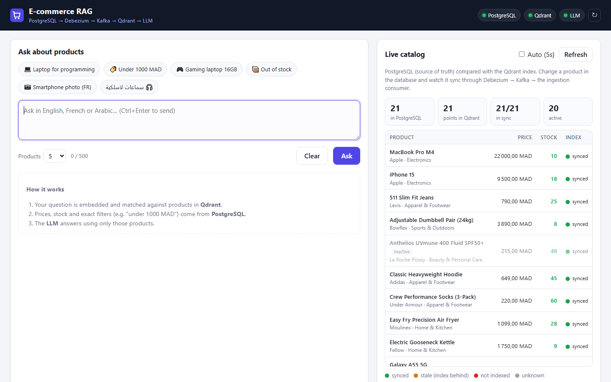

# Real-Time E-commerce RAG

**Natural-language product search over a live catalog, built on PostgreSQL CDC, Debezium, Apache Kafka and vector search.**

Ask *"Show laptops under 10000 MAD"*, *"Trouve-moi un smartphone avec un bon appareil photo"* or *"ابحث عن سماعات لاسلكية"* and get an answer grounded in the **current** catalog. When a product changes in PostgreSQL, the change flows through Debezium and Kafka into the vector index within seconds, and answers always quote live prices and stock straight from the database.



---

## Contents

- [Architecture](#architecture)
- [How a question is answered](#how-a-question-is-answered)
- [Tech stack](#tech-stack)
- [Getting started](#getting-started)
- [Using the system](#using-the-system)
- [API reference](#api-reference)
- [Configuration](#configuration)
- [Testing](#testing)
- [Project structure](#project-structure)
- [Design decisions](#design-decisions)
- [Troubleshooting](#troubleshooting)
- [Known limitations](#known-limitations)

---

## Architecture

```
                 ┌──────────────────── ingestion pipeline (real-time) ─────────────────────┐
                 │                                                                         │
 ┌────────────┐  │  WAL   ┌──────────┐ change ┌─────────────────┐  events  ┌─────────────┐ │
 │ PostgreSQL │──┼──────▶ │ Debezium │──────▶ │ Kafka (KRaft)   │────────▶ │  Python     │ │
 │ products   │  │logical │ (Kafka   │ events │ topic:          │          │  consumer   │ │
 │ categories │  │ repl.  │ Connect) │        │ ecommerce.      │          │  + Sentence │ │
 └─────┬──────┘  │        └──────────┘        │ public.products │          │ Transformers│ │
       │         │                            └─────────────────┘          └──────┬──────┘ │
       │         └────────────────────────────────────────────────────────────────┼────────┘
       │                                                                 upsert / │ delete
       │ prices, stock,                                                           ▼
       │ exact filters      ┌───────────────────────────────────┐          ┌─────────────┐
       └──────────────────▶ │            RAG API (FastAPI)       │ ◀─────── │   Qdrant    │
          (source of truth) │ retrieve → lookup → prompt → LLM   │ semantic │ (vectors)   │
                            └──────────────┬────────────────────┘  search  └─────────────┘
                                           │
                              ┌────────────┴────────────┐
                              │  Web console  /  REST   │ ──▶ LLM: Gemini or Ollama
                              └─────────────────────────┘
```

| Component | Role |
|---|---|
| **PostgreSQL 17** | Source of truth for products and categories. Runs with `wal_level=logical`. |
| **Debezium 2.7** | Captures every INSERT, UPDATE and DELETE from the WAL, including an initial snapshot. |
| **Kafka 7.7 (KRaft)** | Durable event log between capture and indexing, without ZooKeeper. |
| **Ingestion consumer** | Embeds products and upserts them into Qdrant. It re-embeds only when the text that matters for search changes. |
| **Qdrant** | Vector index: 384 dimensions, cosine distance. |
| **RAG API** | FastAPI service with semantic retrieval, authoritative database lookup, grounded generation, and a web console. |

## How a question is answered

```
"laptops under 10000 MAD that are in stock"
   │
   ├─ 1. Filter extraction  → price <= 10000, stock_quantity > 0       (rule-based, never guessed)
   ├─ 2. Semantic search    → Qdrant: top candidates for "laptops…"     (active products only)
   ├─ 3. Database lookup    → PostgreSQL: current price/stock + exact filters, relevance order kept
   ├─ 4. Prompt             → products as numbered context + strict grounding rules
   └─ 5. Generation         → LLM answers in the user's language, citing only those products
```

- **PostgreSQL decides facts.** Prices, stock and active status are never taken from the vector index, which can lag a few seconds behind. A product deleted from the database but still in Qdrant is silently dropped.
- **Exact constraints are enforced in SQL, not by the LLM.** *Under 1000 MAD* becomes `price <= 1000` in a parameterized query. Constraints the system can't extract reliably (brand, RAM, "gaming") stay semantic, and the prompt tells the model to verify them against the product attributes rather than assume them.
- **Grounded answers.** The model may only use the retrieved products. It must not invent products, prices or stock, it must say when information is missing, and it must reply in French, English or Arabic to match the question.

## Tech stack

Python 3.12+, FastAPI, Pydantic, psycopg 3, qdrant-client, Sentence Transformers (`paraphrase-multilingual-MiniLM-L12-v2`), confluent-kafka, httpx, Docker Compose. LLM: **Google Gemini** (API) or **Ollama** (local).

---

## Getting started

### Prerequisites

- Docker Desktop (with Docker Compose v2)
- Python 3.12 or newer
- **One** LLM backend:
  - a [Google AI Studio](https://aistudio.google.com/) API key for Gemini, **or**
  - [Ollama](https://ollama.com/) with a model pulled, e.g. `ollama pull llama3.1:8b`

The commands below are for **Windows PowerShell**. On macOS or Linux use `cp` instead of `copy` and `source .venv/bin/activate` to activate the venv.

### 1. Configure secrets

Secrets live only in git-ignored `.env` files. Templates are provided:

```powershell
copy infrastructure\.env.example infrastructure\.env   # used by docker compose
copy .env.example .env                                  # used when running Python on your machine
```

Edit **both** files:

- set the same `POSTGRES_PASSWORD` in each;
- for Gemini, set `LLM_PROVIDER=gemini` and `GEMINI_API_KEY=...`.

> Never commit `.env` files, and never paste keys into chats or issues.

### 2. Start the infrastructure

```powershell
cd infrastructure
docker compose up -d          # postgres, kafka, debezium, qdrant
docker compose ps             # wait until kafka is "healthy"
```

On first start PostgreSQL runs `postgres/init.sql`, which creates the tables and seeds 5 categories and 20 products.

### 3. Enable change data capture

Create the publication Debezium reads from. This is needed once per database volume:

```powershell
docker exec -it ecommerce-postgres psql -U admin -d ecommerce -c "CREATE PUBLICATION dbz_publication FOR TABLE public.products;"
```

Register the connector. Its password is resolved from Debezium's environment, so the file contains no secret:

```powershell
curl.exe -X POST -H "Content-Type: application/json" --data "@debezium/connector.json" http://localhost:8083/connectors
curl.exe http://localhost:8083/connectors/ecommerce-postgres-connector/status   # expect "RUNNING"
```

### 4. Install Python dependencies

From the repository root:

```powershell
python -m venv .venv
.venv\Scripts\activate
pip install -r requirements.txt -r requirements-dev.txt
```

### 5. Run the ingestion consumer

```powershell
python -m ingestion.main
```

On first run it creates the Qdrant collection and indexes the Debezium snapshot (20 products). Leave it running: it keeps Qdrant in sync with every change.

### 6. Run the RAG API and web console

**Option A, in Docker (recommended).** Services reach each other by name, so host port conflicts don't matter:

```powershell
cd infrastructure
docker compose --profile api up -d --build rag-api
```

The first start downloads the embedding model (about 470 MB) into a volume, which takes a few minutes once.

**Option B, on your machine.** From the repository root, with the venv active:

```powershell
python -m rag_api.main
```

Then open **http://127.0.0.1:8000/ui**.

---

## Using the system

### Web console (`/ui`)

- **Ask** in English, French or Arabic, or click an example. Each answer shows:
  - the **exact filters** that PostgreSQL enforced, or *semantic match only* when there were none;
  - the **source products** with live price, stock and relevance score.
- **Status bar:** live health of PostgreSQL, Qdrant and the LLM.
- **Live catalog:** every product in PostgreSQL, compared with its entry in the Qdrant index:

| Status | Meaning |
|---|---|
| 🟢 synced | The index matches the database. |
| 🟠 stale | The index is behind (hover to see which fields differ). |
| 🔴 not indexed | The product exists in the database but not yet in Qdrant. |

### Watch the pipeline work in real time

Turn on **Auto (5s)** in the catalog panel, then change a product:

```powershell
docker exec -it ecommerce-postgres psql -U admin -d ecommerce -c "UPDATE products SET price = 7499.00 WHERE name = 'ThinkPad E14 Gen 5';"
```

The row flashes, briefly shows *stale*, and turns *synced* once the event has gone through Debezium → Kafka → the consumer → Qdrant. Ask about laptops and the answer quotes the new price. Stop the consumer and the row stays *stale*, which shows that the index depends on the pipeline.

The consumer logs each step:

```
Event received: op=u topic=ecommerce.public.products partition=0 offset=27
Embedding skipped (semantic hash unchanged), payload updated: product 1111…1104
Offset 27 committed
```

A price change doesn't re-embed the product, because only name, description, brand and attributes affect search. Changing the description does.

---

## API reference

Interactive docs: **http://127.0.0.1:8000/docs**

| Method | Path | Description |
|---|---|---|
| `POST` | `/chat` | Ask a question (RAG). |
| `GET` | `/health` | Status of PostgreSQL, Qdrant and the LLM. Returns 200 if all are OK, otherwise 503. |
| `GET` | `/catalog?limit=100` | Read-only catalog with its index sync status. |
| `GET` | `/ui` | Web console. |
| `GET` | `/` | API information. |

### `POST /chat`

```json
{ "question": "Show laptops under 10000 MAD", "top_k": 5 }
```

`question` must be 1–500 characters. `top_k` is 1–20 (default 5).

```json
{
  "question": "Show laptops under 10000 MAD",
  "answer": "Here is a laptop under 10000 MAD: **ThinkPad E14 Gen 5** — 7850.00 MAD, in stock (12 units)…",
  "products": [
    {
      "id": "11111111-1111-4111-8111-111111111104",
      "name": "ThinkPad E14 Gen 5",
      "brand": "Lenovo",
      "category": "Electronics",
      "price": 7850.0,
      "currency": "MAD",
      "stock_quantity": 12,
      "score": 0.5433
    }
  ],
  "applied_filters": ["price <= 10000"]
}
```

| Status | When |
|---|---|
| `422` | Invalid request (empty or too-long question, `top_k` out of range). |
| `502` | The LLM failed. The message gives the reason, e.g. a rate limit or an unavailable model. |
| `503` | PostgreSQL or Qdrant is unavailable. |

Error bodies never contain credentials.

---

## Configuration

All settings come from environment variables or `.env`. Real environment variables take precedence.

| Variable | Default | Description |
|---|---|---|
| `POSTGRES_HOST` / `POSTGRES_PORT` | `localhost` / `5432` | Database address. |
| `POSTGRES_DB` / `POSTGRES_USER` / `POSTGRES_PASSWORD` | `ecommerce` / `admin` / *(none)* | Credentials. The password has no default and must be set. |
| `POSTGRES_HOST_PORT` | `5432` | *Compose only:* host port for PostgreSQL, bound to `127.0.0.1`. |
| `QDRANT_URL` / `QDRANT_COLLECTION` | `http://localhost:6333` / `products` | Vector store. |
| `EMBEDDING_MODEL` | `paraphrase-multilingual-MiniLM-L12-v2` | Shared by ingestion and the API. Changing it requires re-indexing. |
| `LLM_PROVIDER` | `ollama` | `gemini` or `ollama`. |
| `GEMINI_API_KEY` | *(none)* | Required when `LLM_PROVIDER=gemini`. |
| `GEMINI_MODEL` | `gemini-3.8-flash` | Gemini model. |
| `GEMINI_THINKING_BUDGET` | `0` | `0` turns off hidden reasoning tokens, which is much faster for RAG. Leave empty for the model default. |
| `OLLAMA_BASE_URL` / `OLLAMA_MODEL` | `http://localhost:11434` / `llama3.1:8b` | Local LLM. |
| `RAG_DEFAULT_TOP_K` / `RAG_MAX_TOP_K` | `5` / `20` | Number of products per answer. |
| `RAG_MIN_SCORE` | `0.25` | Cosine similarity floor for purely semantic questions. |
| `RAG_MAX_QUESTION_LENGTH` | `500` | Maximum question length in characters. |
| `LOG_LEVEL` / `LOG_FORMAT` | `INFO` / `text` | Set `LOG_FORMAT=json` for JSON-lines logs. |
| `KAFKA_BOOTSTRAP_SERVERS`, `KAFKA_TOPIC`, `KAFKA_GROUP_ID` | `localhost:9092`, `ecommerce.public.products`, `ecommerce-ingestion` | Ingestion consumer. |

---

## Testing

```powershell
pytest -q            # unit tests: no services needed (mocks for Qdrant, PostgreSQL, LLMs)
pytest -m e2e -v     # end-to-end tests against the real stack (uses your .env)
```

| Area | What is covered |
|---|---|
| Retrieval | Query embedding, invalid vectors, Qdrant errors, inactive filter, score floor |
| Database | Relevance order kept, deleted or inactive products dropped, parameterized SQL, injection attempts |
| Filters | English, French and Arabic price and stock extraction; never inventing a filter (*"16GB RAM"* isn't a price) |
| Prompt | Grounding rules, explicit out-of-stock, empty-context behaviour |
| LLMs | Ollama and Gemini request shape, timeouts, retries on overload, errors without key leaks |
| RAG workflow | End-to-end orchestration, dependency failures |
| API | Validation (422), error mapping, health, catalog, UI security headers |
| E2E | Real embeddings, Qdrant, PostgreSQL and LLM through the HTTP API |

E2E tests skip themselves, with a reason, when a service is unreachable.

---

## Project structure

```
.
├── infrastructure/
│   ├── docker-compose.yml        # postgres, kafka, debezium, qdrant (+ rag-api profile)
│   ├── .env.example              # compose secrets template
│   ├── postgres/init.sql         # schema + seed data
│   └── debezium/connector.json   # CDC connector (password via ${env:...})
├── ingestion/                    # Kafka → embeddings → Qdrant
│   ├── main.py
│   ├── config.py
│   ├── consumer/kafka_consumer.py
│   ├── embeddings/embedding_service.py
│   └── vector_store/qdrant_service.py
├── rag_api/                      # FastAPI RAG service
│   ├── main.py                   # app, error mapping, lifespan
│   ├── config.py                 # settings (reuses ingestion's model config)
│   ├── dependencies.py           # composition root: one model, shared clients
│   ├── routes/                   # chat, health, catalog, web
│   ├── schemas/                  # Pydantic request/response models
│   ├── services/
│   │   ├── retriever.py          # Qdrant semantic search
│   │   ├── product_lookup.py     # PostgreSQL source of truth
│   │   ├── query_parser.py       # exact filter extraction (extension point)
│   │   ├── prompt_builder.py     # grounded prompt
│   │   ├── llm_service.py        # Ollama
│   │   ├── gemini_service.py     # Gemini
│   │   ├── catalog_service.py    # DB vs index sync view
│   │   └── rag_service.py        # orchestration
│   ├── database/postgres.py      # read-only connections
│   ├── core/                     # logging, exceptions
│   ├── web/static/               # console: HTML/CSS/JS, no external dependencies
│   └── Dockerfile
├── tests/                        # unit tests + tests/e2e
├── requirements.txt
├── requirements-dev.txt
└── .env.example                  # local secrets template
```

---

## Design decisions

**Ingestion**
- **At-least-once delivery.** Kafka offsets are committed only after Qdrant confirms the write. Failed events are retried with backoff and never skipped. Upserts are idempotent, so replays are safe.
- **Skip unnecessary embeddings.** Each point stores a `semantic_hash` of name, description, brand and attributes, computed over canonical JSON so key order doesn't matter. When only price or stock changes, the consumer updates the payload and skips re-embedding.
- **Deletes and tombstones** are handled. Debezium's tombstone after each delete is acknowledged and ignored.

**RAG API**
- **Over-fetch, then filter.** Qdrant returns 4× `top_k` candidates (up to 50 when exact filters are active), PostgreSQL applies the filters, and the result is trimmed to `top_k`. A price filter therefore can't empty the result just because the closest semantic matches were over budget.
- **No similarity floor for filtered queries.** *"Products under 1000 MAD"* has little semantic content. The floor applies only to purely semantic questions, where it keeps off-topic questions (*"weather tomorrow?"*) from retrieving junk.
- **Conservative filter parser.** A price is extracted only when the amount has a currency, and ambiguous numbers are ignored. `QueryParser` is a protocol, so an LLM-based or schema-driven parser can replace the rule-based one without touching the pipeline.
- **One embedding model per process,** reused from the ingestion package, so the query and the index always use the same model.
- **LLM-agnostic.** Gemini and Ollama share one interface, selected by `LLM_PROVIDER`. Gemini retries on overload (429/5xx) and runs without "thinking" tokens. In our measurements that took one answer from about 10 s to about 2 s.

**Security**
- Secrets live only in git-ignored `.env` files. Debezium resolves the database password from its environment (`${env:POSTGRES_PASSWORD}`).
- PostgreSQL is published on `127.0.0.1` only.
- The API uses **read-only** database sessions and parameterized SQL only.
- The Gemini key travels in a header, never in a URL, log or error message.
- The web console loads no third-party code. It sends a strict Content-Security-Policy, and every model or database string is escaped before rendering.

---

## Troubleshooting

| Symptom | Cause and fix |
|---|---|
| `password authentication failed` from your machine, with a localized (e.g. French) message | Another PostgreSQL, such as a native Windows service, owns port 5432. Set `POSTGRES_HOST_PORT=5433` in `infrastructure/.env`, `POSTGRES_PORT=5433` in `.env`, then run `docker compose up -d`. |
| Requests from Python take seconds longer than expected on Windows | `localhost` tries IPv6 first. Use `127.0.0.1` in `.env`. |
| The API uses an old or revoked Gemini key despite `.env` | A `GEMINI_API_KEY` **environment variable** takes precedence. Remove it with `[Environment]::SetEnvironmentVariable("GEMINI_API_KEY", $null, "User")`, then restart your terminal or IDE. |
| `Gemini model '…' is not available: … no longer available to new users` | Newer Google projects can't use retired models. Set `GEMINI_MODEL` to the model Google suggests. |
| `Gemini quota or rate limit exceeded` | Free-tier limits per minute or day. Wait and retry. Transient overloads are already retried automatically. |
| Catalog rows stay *stale* or *not indexed* | The ingestion consumer isn't running (`python -m ingestion.main`), or the connector isn't `RUNNING`. |
| Connector fails with `publication "dbz_publication" does not exist` | Run the `CREATE PUBLICATION` command from [step 3](#3-enable-change-data-capture). |
| `rag-api` container takes minutes to become ready | First start downloads the embedding model into the `hf_cache` volume. Later starts take seconds. |
| Ollama unreachable from the `rag-api` container | Ollama runs on the host. Set `OLLAMA_HOST=0.0.0.0` for Ollama. The container reaches it at `host.docker.internal:11434`. |
| Arabic text arrives garbled when testing with `curl` in Git Bash | That's a Windows console encoding issue. Use the web console, `/docs`, or Python instead. |

---

## Known limitations

- **Filter extraction is rule-based.** It covers price bounds with a currency and stock wording in English, French and Arabic. Brand, specs ("16GB RAM") and use cases are matched semantically and verified by the LLM against attributes, not enforced in SQL.
- **Listing queries are best-effort on large catalogs.** *"Which products are out of stock?"* is answered from the most relevant candidates (up to 50), not by a full table scan.
- **Large text fields and CDC.** With PostgreSQL's default `REPLICA IDENTITY`, an UPDATE that doesn't touch a large (TOASTed) `description` or `attributes` may arrive from Debezium with a placeholder value. The seed data is far below that size. For production, run `ALTER TABLE products REPLICA IDENTITY FULL;`.
- **The Ollama backend** is covered by unit tests and a protocol-level stub. End-to-end runs in this project were done with Gemini.
